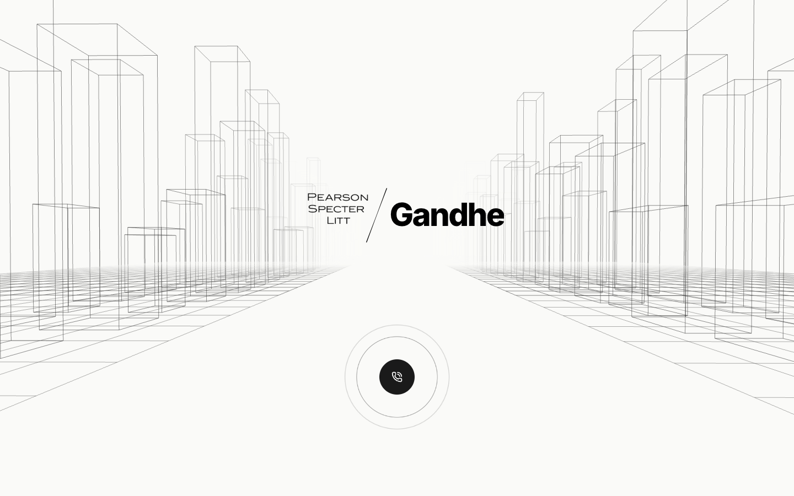

<div align="center">



# harvey

a lawyer that picks up. you call, ask a legal question out loud, and he answers by voice and puts the actual statute on screen.

[try it](https://harvey-two.vercel.app/) · [watch the demo](https://www.loom.com/share/2f671a72a279425d84bf5baa298d1efd)

</div>

## why i built this

i built this as a student. my friends and i ran into dumb legal situations all the time. someone gets pulled over doing 50 over. someone's landlord serves an n12. someone gets fired the week before payday. the answer is always the same: we don't know, and nobody is calling a lawyer over it.

so i built one you can just call. it covers the law students actually bump into (traffic, tenancies, employment, criminal code, cannabis, consumer stuff) and grounds every legal answer in real statute text.

it's a demo, not legal advice. harvey says so himself when a question gets heavy.

## what you can ask

- **canadian legal questions.** he cites the statute from a 5,668 chunk corpus of ontario and federal law.
- **news.** he pulls live headlines and gives you the one sentence version.
- **public companies.** live quote with price, change, day range and 52 week range.
- **congressional trades.** recent stock act disclosures for a ticker.

every one of these is a tool call, and every tool call opens its own pane on screen, so you can see what he's citing while he talks.

## how it works

```
 browser (next.js)
   │  GET /api/token        mint a livekit token
   │  webrtc audio up, data channel down
   ▼
 livekit cloud
   │  dispatches the call to the agent worker
   ▼
 python agent (fly.io)
     deepgram nova-2        speech to text
     claude                 llm + tool calling (you pick: opus 5.5, sonnet 5.5 or haiku 5.5)
     elevenlabs turbo v2.5  text to speech (openai tts as backup)
     silero                 voice activity detection

     tools:
       cite_statute     chroma (rag)
       current_events   google news rss
       stock_ticker     yahoo finance
       check_the_hill   quiverquant, or a bundled dataset
       manage_screen    moves panes around
       end_call         hangs up
```

one turn, start to finish:

1. you hit call. the frontend gets a token and joins the room.
2. the agent joins and says hello right away with a canned line, so you hear something before the llm is even warm.
3. you talk. deepgram streams the transcript, vad and turn detection decide when you're done.
4. the llm either answers or calls a tool. you pick which claude model he runs on before you call.
5. the tool publishes a json event on the livekit data channel. the frontend catches it and opens a pane.
6. harvey talks, and the pinwheel reacts to his audio.

## the rag part

7 english sources, 5,668 chunks, stored in chroma.

| source | chunks |
|---|---|
| ontario highway traffic act | 1,100 |
| canada criminal code | 3,276 |
| ontario residential tenancies act | 392 |
| ontario employment standards act | 359 |
| controlled drugs and substances act | 240 |
| cannabis act | 257 |
| ontario consumer protection guides | 44 |

plain cosine similarity kept failing on the way students actually ask things. "n12" has no semantic link to "notice of termination", and "assault" kept pulling the highway traffic act just because it has the most chunks.

the fix was two stages:

1. a small claude haiku 5.5 call (gpt-4o-mini if there's no anthropic key) classifies the question, picks the source, rewrites the query and guesses the likely section numbers.
2. chroma searches inside that source if the classifier is confident (0.6 or higher), otherwise it searches everything with a keyword boost.

chunks are 1000 characters with 200 overlap, embedded with `text-embedding-3-small`. the top chunk goes to the llm so he can say it, the top three go to the card on screen.

the first version of the corpus was bigger and worse. i ingested 31 pdfs including bilingual federal statutes, and the french and english were interleaved on the same page, which poisoned the embeddings. smaller and cleaner won.

## tradeoffs i made

- **you pick the brain.** the call screen lets you choose opus 5.5, sonnet 5.5 or haiku 5.5. the choice rides along as a participant attribute and the agent builds the llm from it. no anthropic key set, and it falls back to gpt-4o-mini.
- **chroma embedded, not a managed vector db.** zero ops, ships inside the docker image. it would not scale sideways.
- **livekit instead of raw webrtc.** turn detection, vad, transcripts and the data channel come for free.
- **fixed corpus, no uploads.** the time went into retrieval quality and the ui instead.
- **bundled congress data as a fallback.** the live endpoint needs a paid key, so `data/congress_trades.json` keeps the tool working without one.

## run it

you need python 3.11+, node 20+, a livekit cloud project, and keys for anthropic, openai (embeddings and the retrieval router), deepgram and elevenlabs.

agent:

```bash
cd backend
python3 -m venv .venv
source .venv/bin/activate
pip install -r requirements.txt
cp .env.example .env                 # fill in your keys
python ingest_student_laws.py        # builds data/chroma_db, takes a few minutes
python agent.py dev
```

frontend:

```bash
cd frontend
cp .env.local.example .env.local     # livekit url + key + secret
npm install
npm run dev                          # http://localhost:3000
```

## deploy

- **frontend on vercel.** root directory is `frontend/`, three env vars: `LIVEKIT_API_KEY`, `LIVEKIT_API_SECRET`, `NEXT_PUBLIC_LIVEKIT_URL`. the token route is rate limited per ip.
- **agent on fly.io.** `bash deploy/revive.sh`. it reads your keys from the environment, checks each one against its provider, sets them as fly secrets and deploys. it never prints a value. the worker is outbound only, so there's no public http surface.
- **testing a local worker next to the hosted one.** set `HARVEY_AGENT_NAME` and the worker only takes rooms explicitly dispatched to that name, so it never steals real calls. unset, it takes every room like before.
- there's an aws fargate path in `deploy/DEPLOY.md` too.

## built with

livekit · deepgram nova-2 · claude opus 5.5 / sonnet 5.5 / haiku 5.5 · elevenlabs turbo v2.5 · silero vad · langchain · chroma · next.js 16 · react · framer motion · tailwind · three.js · fly.io · vercel
